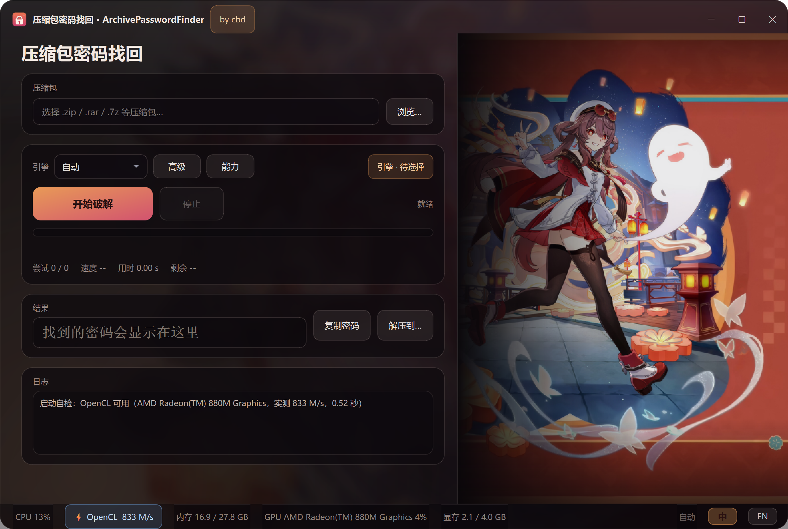
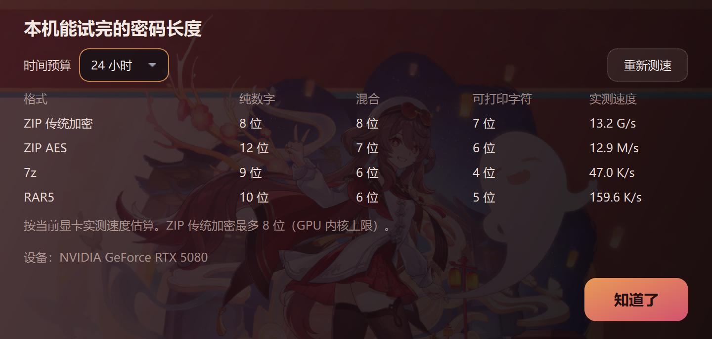
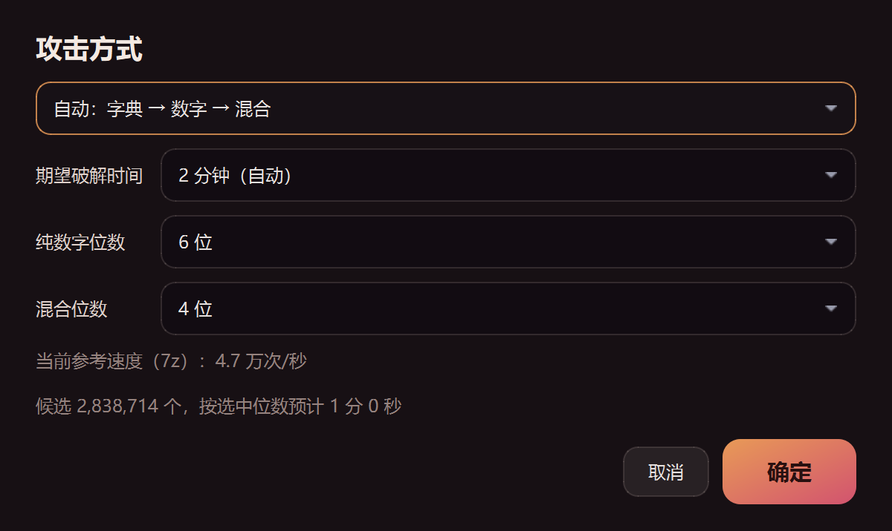

# 压缩包密码找回

Windows 下的小工具，用来找回自己压缩包的密码。双击 exe 就能用，不需要装 Python、7-Zip 或运行库。

当前版本 v1.0.1。支持 ZIP（ZipCrypto）、RAR / RAR5、7Z、AES-ZIP，以及 7-Zip 能打开的其他格式。

更新记录见 [CHANGELOG.md](CHANGELOG.md)。



启动能力弹窗（背景为胡桃立绘）：



高级设置：



## 功能

- 启动弹窗：带胡桃背景，按当前显卡实测速度直接给出 2 分钟 / 10 分钟 / …… / 24 小时能试完的密码长度
- 自动阶梯：字典 → 纯数字 → 混合（字母+数字）；长度按“期望破解时间”自动换算，也可以手动改
- 高级设置：期望时间（2 分钟默认 / 10 分钟 / 30 分钟 / 1 小时 / 6 小时 / 24 小时 / 3 天 / 无限 / 自定义），
  纯数字和混合各选多少位；参考速度按当前压缩包格式取，只跑字典或自定义字符集
- 说明：位数先按不超过目标取最大，再和上一位比较，选预计总时间更接近目标的组合（可能略超）
- 无限模式：字典后按 1 位数字、2 位数字、1 位混合、3/4 位数字、2 位混合… 交替，日志只写当前测的位数
- 引擎选择有实际作用：
  - CPU：C 多线程（Win32 线程 + zlib 完整 CRC 校验）
  - CUDA：NVIDIA 驱动 API 直接加载预编译 PTX，用户机器不需要装 CUDA Toolkit
  - OpenCL：AMD / Intel / 老 NVIDIA 驱动都能用，CUDA 不可用时自动顶上
  - hashcat（GPU）：AES-ZIP、7z、RAR5 交给 hashcat 在显卡上跑；多显卡优先 NVIDIA / AMD 独显
  - 7-Zip：RAR3 / 旧格式等兜底校验
- 启动自检：打开后 1 秒内跑一次真实扫描，状态栏 CPU 旁边直接显示当前用的是 CPU / OpenCL / CUDA 与实测速度
- 中/EN 直接点选，拖拽压缩包、无边框玻璃界面
- 便携：不联网、不写注册表、不装服务

## 直接使用

到 [Releases](https://github.com/d1zzyyyuki/vibecoding/releases) 下载 `ArchivePasswordFinder-v1.0.1.exe`，双击运行即可。

## 从源码运行

```bat
python -m venv venv
venv\Scripts\python -m pip install -r requirements.txt
venv\Scripts\python tools\get_hashcat.py   :: 下载 hashcat 运行包（可选，第一次构建前跑一次）
venv\Scripts\python ui.py
```

仓库里已经带了 `zipcpu.dll`、`assets/7z.exe` 和 `assets/cuda/*.ptx`。
hashcat 运行包和 7z2hashcat 体积较大，没有放进 git，用上面的命令获取；
没有它们时程序会自动跳过 GPU hashcat 路径。
如果要自己重新编译 CPU 引擎或 CUDA 内核，见 [docs/BUILD.md](docs/BUILD.md)。

## 硬件加速支持

CUDA 后端通过 `nvcuda.dll`（NVIDIA 显卡驱动自带）加载 PTX，运行时会按显卡算力和驱动版本挑选最合适的一份：

| 显卡架构 | 计算能力 | 使用的 PTX |
|---|---|---|
| Fermi | sm_20 | ISA 5.0（CUDA 8.0 编译） |
| Kepler | sm_30 / 32 / 35 / 37 | ISA 5.0 / 7.8 |
| Maxwell | sm_50 / 52 / 53 | ISA 5.0 / 7.8 / 8.8 |
| Pascal | sm_60 / 61 / 62 | ISA 5.0 / 7.8 / 8.8 |
| Volta / Turing | sm_70 / 75 | ISA 7.8 / 8.8 |
| Ampere | sm_80 / 86 / 87 | ISA 7.8 / 8.8 |
| Ada / Hopper | sm_89 / 90 | ISA 7.8 / 8.8 |
| Blackwell | sm_100 / 103 / 120 / 121 | ISA 8.8 |

没有 NVIDIA 显卡，或者 PTX 加载失败时，会自动回退到 OpenCL，再不行用 CPU，不会卡在 CUDA 上。

在自己的机器上确认实际用的是哪个后端：

```bat
ArchivePasswordFinder.exe --selftest --out selftest.json
ArchivePasswordFinder.exe --capability --out capability.json   :: 24 小时能力评估（含 hashcat 测速，约 10 秒）
```

`backend` 是 `cuda` / `opencl` / `cpu`，`rate` 是实测候选/秒，`detail` 里会写用了哪份 PTX。
`--capability` 会给出 ZIP 传统加密 / ZIP AES / 7z 在各种字符集下 24 小时能覆盖的位数。

## 测试

```bat
venv\Scripts\python tests\test_smoke.py
venv\Scripts\python tests\test_cuda.py
venv\Scripts\python tests\test_hashcat.py
venv\Scripts\python tests\test_capability.py
```

`test_cuda.py` 里的模拟显卡驱动（`tools/mock_nvcuda.c`）需要本机有 gcc，没有则跳过模拟驱动相关的用例；
PTX 选型、内核索引映射、自检等用例不需要显卡。
`test_hashcat.py` 需要先获取 hashcat 运行包，没有则自动跳过。
`test_capability.py` 只做长度换算，不需要显卡。

## 已知限制

- RAR5 可以走 GPU（hashcat -m 13000）；RAR3 / 更老的 RAR 仍走 7-Zip 逐候选校验（CPU）。
- ZIP 传统加密的 CUDA / OpenCL 内核最长支持 8 位；自动模式只跑到 8 位，
  更长的可以用“高级 → 自定义字符集”走 CPU。AES-ZIP / 7z / RAR5 走 hashcat，没有这个限制。
- CUDA 内核只支持程序实际用到的候选形态：无前后缀、密码 ≤ 8 位、字符集 ≤ 255 个字符。
- 7z 的 KDF 迭代次数因压缩包而异，速度/时间估算按常见默认值计算；以运行时日志为准。
- 自动阶梯覆盖的是较短密码和常见密码，超长随机密码不现实。

## 致谢与声明

- 7-Zip 二进制来自官方发布，遵循 GNU LGPL（`assets/7z-License.txt`）。
- hashcat 8.0.0 遵循 MIT（`assets/hashcat/LICENSE.hashcat.txt`），PySide6 / Qt6 遵循 LGPLv3（`assets/LGPL-3.0.txt`）。
- 界面右侧立绘由项目作者提供并授权随本软件使用，版权归原权利方所有。
- 完整第三方说明见 `assets/THIRD_PARTY_NOTICES.txt`。
- 本工具仅用于找回自己拥有或已获授权的压缩包密码。

## License

MIT，见 [LICENSE](LICENSE)。第三方组件和图片的版权归各自作者所有。
