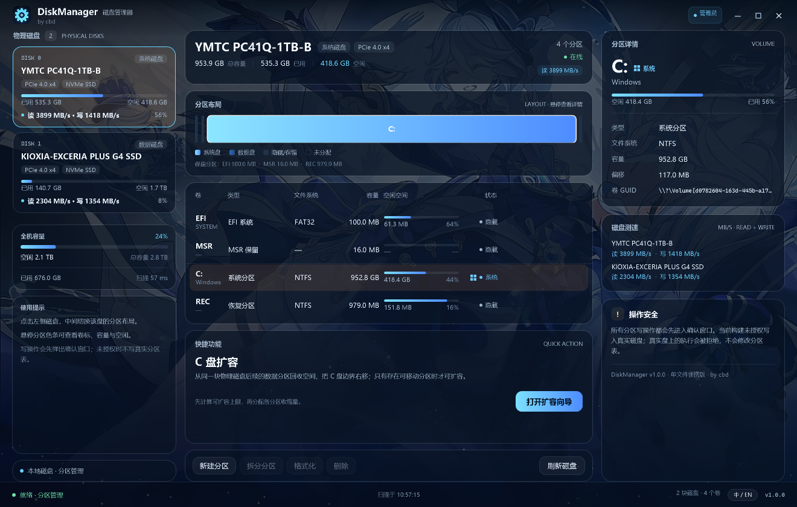
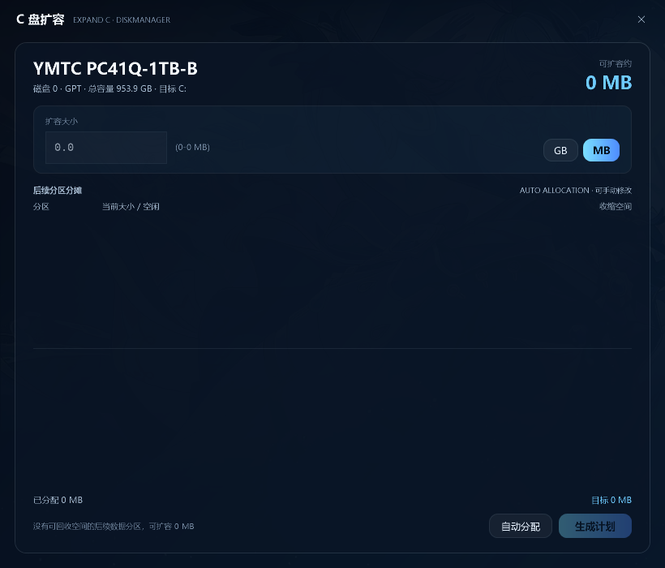
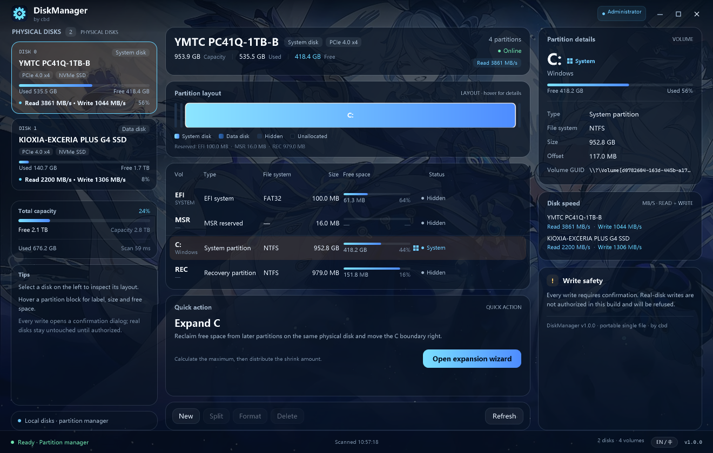
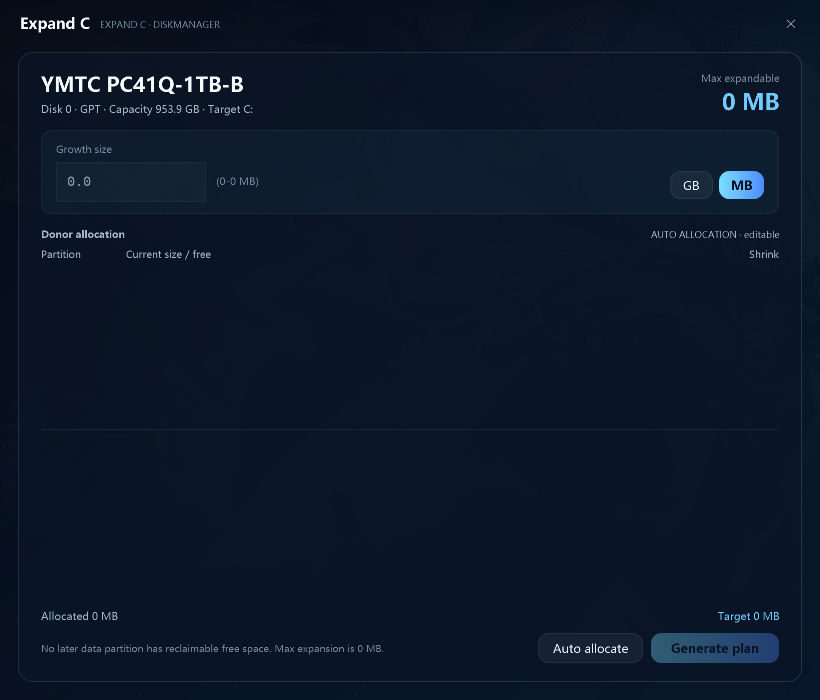

# DiskManager 磁盘管理器


**v1.0.0 · Windows 10/11 x64 · 单文件便携 · by cbd**

> **半成品预览：** 真实磁盘写入尚未授权，PE 镜像和完整双语等仍未完成；当前版本只建议用于查看与规划。
>
> [下载 v1.0.0 预览版](https://github.com/d1zzyyyuki/vibecoding/releases/tag/diskmanager-v1.0.0)


DiskManager 是一个冷色重设计的磁盘管理器：深蓝玻璃界面、芙宁娜背景、蓝色齿轮图标；保留按物理磁盘展示分区、读写测速、在线分区搬移、分区操作和 C 盘扩容规划。





## 这次改了什么


- 统一命名：中文“磁盘管理器”，英文“DiskManager”；左上角 `by cbd`。

- 冷色蓝主题，重做背景、卡片、描边和状态色；背景使用芙宁娜素材。

- 新 exe 图标：冷色蓝色齿轮，参考 iOS 设置图标的语义，不使用苹果商标素材。

- 磁盘测速改为 **MB/s**，同时显示顺序读取和写入（写入使用临时文件，不碰分区表）。

- 去掉右上角重复刷新、整卷搬移预计面板、跨物理盘说明和旧的“进入规划”流程卡。

- 基本分区按钮已接入操作窗口：新建、拆分、格式化、删除；真实磁盘执行仍受安全限制。

- 右下角增加 `中 / EN` 语言切换（当前覆盖主导航/快捷卡片，数据字段和子窗口的英文仍在接入）。

- C 盘扩容改为**多分区分摊**：

  - 只有 C 盘，或 C 后面没有可回收数据分区时显示 `可扩容 0 MB`；

  - 可扩容上限按后续分区空闲空间计算，超过 1 GB 用 GB、否则用 MB，保留 1 位小数；

  - 自动按“优先补足空闲最少的分区，再均分剩余”的规则分摊；

  - 用户可以修改任一分区的收缩值，其他分区的值自动重算，总和始终等于 C 扩容量；

  - 支持 GB/MB 单位切换；

  - “生成计划”会写出带 SHA256 的 `job-*.json`，供后续 PE 离线执行使用。











## 当前可用能力


| 能力 | 状态 |

|---|---|

| 按物理磁盘展示 GPT/MBR、分区、卷、文件系统、容量与空闲 | 可用 |

| NVMe PCIe 链路、NVMe/SATA 类型、型号识别 | 可用，本机实测 PCIe 4.0 x4 |

| 启动读取测速 + 临时文件写入测速，单位 MB/s | 可用 |

| 分区布局、卷详情、保留分区摘要 | 可用 |

| 新建 / 拆分 / 格式化 / 删除的确认窗口 | 可用；真实磁盘写入尚未授权 |

| C 盘扩容多分区分摊、单位切换、自动/手动编辑、任务 JSON、PE 任务暂存 | 可用（规划） |

| 离线任务校验/计划器 `DiskManagerOffline validate/plan` | 已编码，VHD 任务测试通过 |

| 离线多分区右移执行器 `DiskManagerOffline run` | 已编码；12 GB VHD 上完成收缩/右移/GPT/扩 C，payload 哈希一致 |

| PE 镜像构建脚本 `tools/pe/build-pe.ps1` | 已写；构建步骤待完成，见 [TODO](docs/TODO.md) |

| 在线搬移/扩卷引擎 | 代码保留，曾在 VHD 上完成破坏性验证；本轮未重跑 |

| PE 离线自动右移 | 离线执行器已在 VHD 跑通；PE 镜像未构建/未实测，见 `docs/PE-OFFLINE.md` |

| 中/EN 切换 | 主界面、C 扩容窗口、分区工具窗口已覆盖；少量 Core 错误信息仍可能中文 |


## 实测数据（2026-11-25）


| 项目 | 结果 |

|---|---|

| 单文件 | `dist\DiskManager.exe`，623,104 字节，SHA256 `691D1A1E…E381194C`（隔离目录单独运行通过） |

| 启动到窗口可交互 | 约 161–209 ms（含读写测速的扫描阶段） |

| 扫描 + 读写测速 + PCIe | 约 57–59 ms |

| 顺序读 | 约 2.2–2.9 GB/s（本机 NVMe） |

| 写入（临时文件） | 约 0.7–1.0 GB/s（本机 NVMe，受 Defender/缓存影响） |

| 单元测试 | **38/38 PASS**（扩容分摊、固定值重分配、可扩容上限、GPT 多分区补丁） |

| selftest | 7/7 PASS（约 59 ms） |

| Defender | 最终 exe 扫描 no threats |


旧版的 VHD 引擎证据仍保留在 `docs/evidence/m2-online-engine-2026-11-24.md` 和 `docs/evidence/m4-partition-ops-2026-11-24.md`；那是重命名前的核心代码证据，不是本次新 UI 的截图。


## 构建


要求：Windows 10/11，.NET SDK 8（编译/测试），.NET Framework 4.8（运行）。

在仓库根目录执行：


```powershell

cd 02-DiskManager

.\tools\build.ps1

.\tools\verify.ps1

```


产物：`dist\DiskManager.exe`。


## 目录


```

src/DiskManager.App/       WPF 界面、主题、扩展 C 窗口、分区工具窗口

src/DiskManager.Core/      扫描/GPT/规划/搬移/分区操作/测速

src/DiskManager.Offline/ .NET 8 离线任务校验/计划/执行器

tests/DiskManager.Tests/   38 项测试

tools/                   构建、验证、截图、VHD 实验、PE 构建脚本

docs/                    测试报告、架构、PE 设计、截图、历史证据

assets/                  蓝色齿轮图标与素材

dist/                    DiskManager.exe

```


## 单文件说明

- 主程序 dist\DiskManager.exe 是唯一运行文件，背景图/图标/主题/Core 全部嵌入 exe；在空目录只放这一个文件运行/截图通过。
- 依赖 Windows 自带 .NET Framework 4.8；Windows 10/11 默认具备。
- PE 使用的 DiskManagerOffline.exe 是另一个离线工具，不属于主程序的运行依赖。
- 未做代码签名；Defender 本机实测 no threats，但无法保证所有杀软都不误报。

## 安全边界


- **没有授权写真实磁盘**：主界面按钮会打开操作窗口，但真实磁盘执行会明确拒绝；当前不会修改真实分区表。

- 之前的破坏性测试全部在 VHD 上完成，VHD 已清理；host 磁盘未改动。

- C 盘扩容 UI 生成计划后会把同一 job 复制到 `%ProgramData%\DiskManager\pe\job.json`；PE 构建脚本会自动带入，但仍需要 PE 镜像/重启执行。

- PE 镜像未构建，构建步骤待完成，见 [TODO](docs/TODO.md)；`tools/pe/build-pe.ps1` 已写好；离线执行证据见 [VHD 实测](docs/evidence/offline-run-2026-11-25.md)。

- 离线执行器默认只允许虚拟磁盘；真实盘必须显式 `--allow-real`，且当前尚未授权。

- 中英切换已覆盖主界面、C 扩容窗口和分区工具窗口；Core 抛出的个别错误文本仍可能沿用中文。

- 无代码签名；SmartScreen 可能提示，Defender 本机实测无威胁。

- MBR 解析代码存在，但没有 MBR 测试盘；SATA HDD/SSD 也没有真实样本。


## 路线图


| 阶段 | 内容 | 状态 |

|---|---|---|

| UI v1.0 | 冷色蓝玻璃、Furina 背景、改名、齿轮图标、读写测速、基本操作窗口 | 已完成本轮 |

| C 扩容规划 | 多分区分摊、单位、编辑、任务 JSON、离线校验/计划 | 已完成规划/校验层 |

| PE v1.0 | WinPE 镜像、离线执行引擎、自动右移、恢复日志 | 离线执行器 VHD 通过；PE 构建/恢复未完成 |

| 真实盘验收 | 同盘 C/D 测试机；需要明确授权 | 未执行 |

| 全量双语 | 子窗口与数据字段英文 | 待做 |

